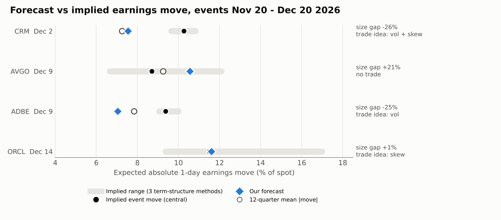
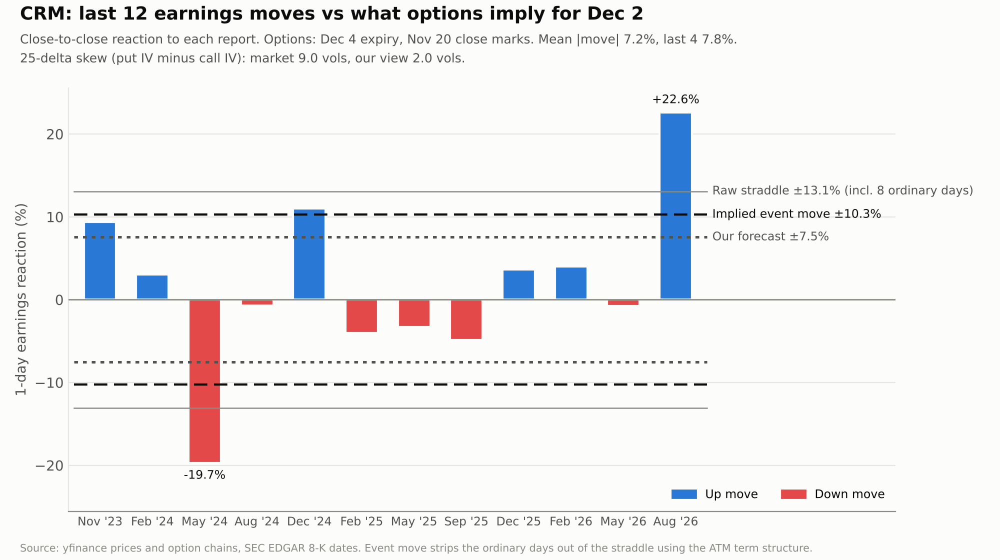
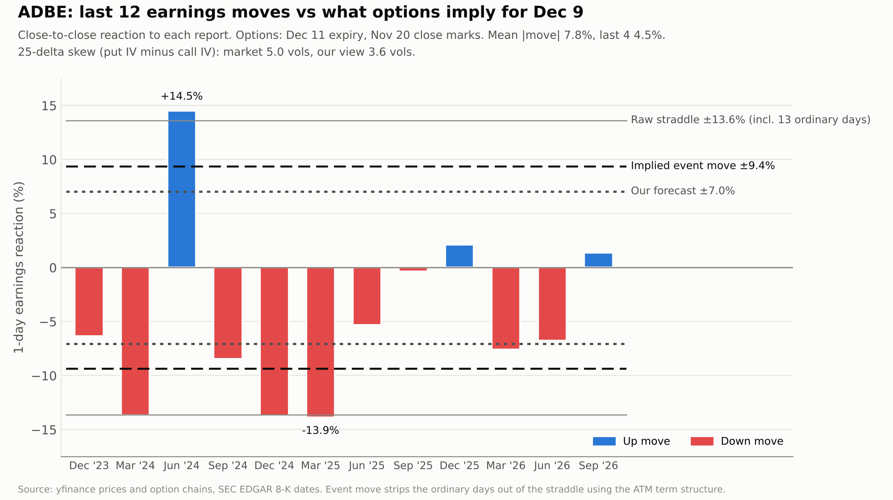
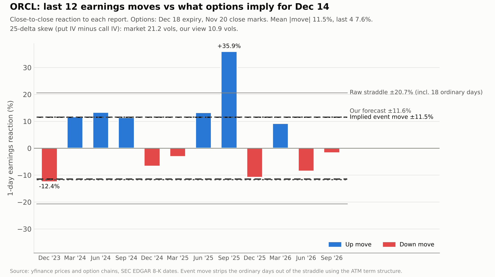

# Event Distribution Report: US large-cap tech, Nov 20 to Dec 20, 2026

As of the Fri Nov 20, 2026 close. Options marks are Friday closing quotes pulled over the weekend. Analysis only; no orders were placed.

## Summary

| Ticker | Event (after close) | Implied move: event-only (raw straddle) | Our forecast | Gap | Direction (conf.) | Skew: market vs ours (25d RR, vols) | Trade idea |
|---|---|---|---|---|---|---|---|
| CRM | Dec 2 | 10.3% (13.1%) | 7.5% | -2.7 pts (-26%) | up (3/5) | 9.0 vs 2.0 | **Yes**: vol + skew |
| AVGO | Dec 9 | 8.7% (16.7%) | 10.6% | +1.9 pts (+21%) | neutral (2/5) | 20.7 vs 13.1 | No |
| ADBE | Dec 9 | 9.4% (13.6%) | 7.0% | -2.3 pts (-25%) | down (2/5) | 5.0 vs 3.6 | **Yes**: vol |
| ORCL | Dec 14 | 11.5% (20.7%) | 11.6% | +0.1 pts (+1%) | neutral (2/5) | 21.2 vs 10.9 | **Yes**: skew |
| AAPL, MSFT, NVDA, GOOGL, AMZN, META, AMD, NFLX | no catalyst in window | | | | | | No |

**Bottom line.** 3 trade ideas out of 4 events. CRM is the best idea: event vol looks rich *and* the put skew looks rich, which points to a short iron fly with the put wing pushed out. ADBE is a smaller short-vol idea that leans on recent quiet prints. ORCL is a pure skew trade: the size of the move is fairly priced, but the downside tail is priced far fatter than ORCL's history. AVGO is no trade: our forecast sits inside a very wide implied range, and its skew quote is too wide to trade off a weekend mark.

**Thresholds (set before looking at results).** Vol: |forecast - implied| at least 20% of implied and 1.0 pt, *and* the forecast outside the implied range from three term-structure methods. Skew: model vs market 25d risk reversal at least 3 vols *and* wider than the RR's own bid/ask. Direction: confidence 4/5 or more (none qualified). Why 20%: the standard error of a 12-print mean |move| is 20-30% of the mean for these names, and the event-only implied move moves by 1-2 pts across reasonable term-structure assumptions; anything smaller is noise.



**Backdrop.** Week of Nov 16-20 2026: AI-trade unwind. SPY -8.6% and QQQ -10.5% on the week, SMH -17.8%, IGV -9.4%, VIX 35.9. NVDA -14% on Nov 20 after its CEO resigned and Reuters reported an SEC review of its accounting. Anthropic IPO priced Nov 19 and did not stop the selloff. 1-month implied correlation jumped above 30 (Bloomberg via Investing.com). All four names report into this tape, so single-stock prints compete with macro and factor moves.

## Name by name

### CRM: Q3 FY27 results, Wed Dec 2 after the close (confirmed)

Spot 180.62. Implied event move **10.3%** (range 9.7-10.8%), raw Dec 4 straddle 13.1%. Our forecast **7.5%**. Call: **up, 3/5**. Trade idea: **yes (vol + skew)**.

**Base rates (last 12 prints, 1-day close-to-close)**

| Mean abs | Median abs | Std (signed) | Mean signed | Largest up | Largest down | Up / down | EPS beats (of prints with data) |
|---|---|---|---|---|---|---|---|
| 7.3% | 4.0% | 10.3% | +1.7% | +22.6% | -19.7% | 6 / 6 | 11 of 12 |

Moves, oldest first: +9.4, +3.0, -19.7, -0.7, +11.0, -4.0, -3.3, -4.9, +3.7, +4.0, -0.8, +22.6. Last 4 average 7.8%. Standard error of the mean |move| is 2.1 pts.

**What options imply**

- ATM IV: pre-event Nov 27 expiry 62%, event Dec 4 expiry 87%, forward ex-event vol after the print 52%.
- Event-only move 10.3% (piecewise term structure). Bounds: 9.7% if every ordinary day runs at the pre-event IV, 10.8% if they all run at the forward vol.
- Skew: 25d put IV 91% (K~163) vs 25d call IV 82% (K~203), **RR 9.0 vols** (bid/ask half-width 5.6). Pre-event expiry RR 12.6. Implied event skewness -0.6 (negative = market fears a drop more than a jump).

**Fundamental view**

- *Consensus vs guidance:* Company guide (Aug 26 release): revenue $11.42-11.50B (+11-12% Y/Y, ~4 pts from Informatica), non-GAAP EPS $3.42-3.44, cRPO ~14% Y/Y. Consensus: revenue $11.46B (exactly the guide midpoint), EPS $3.45 (one cent above the top of the guide, 42 analysts). The bar is not demanding.
- *Revisions:* Quarter EPS consensus +2.3% over 90 days, flat over 30 days (1 up, 1 down). FY27 EPS +18.5% over 90 days after the Q2 beat and the ASR share-count cut.
- *Tone of last release:* Very upbeat: 'one of our best quarters ever', NNAOV growth the strongest in four years, 'on track for second-half organic revenue reacceleration', FY27 revenue guide raised $200M. Contentful and Fin acquisitions pending; $25B ASR settled in October. ([EX-99.1](https://www.sec.gov/Archives/edgar/data/1108524/000110852426000187/crm-q2fy27xexhibit991.htm))
- *Sector news since last report:* Software sold off into the Anthropic IPO on AI-substitution fears. CRM -17% on the week, -25% over a month and about -28% from the post-Q2 close. Headlines: another round of layoffs, ETF net selling three days running, Oppenheimer says the low bar sets up a beat, Piper sees 53% upside.
- **Call: up, confidence 3/5.** Consensus sits at the guide midpoint and management has publicly committed to 2H organic reacceleration, so the numbers bar is low. The de-rating came from sector fear, not company numbers (forward P/E ~11). Capped at 3 because correlation is high and the macro tape can swamp a good print.

**Our forecast (math)**

```
base     B = 0.6*7.25 + 0.4*7.76            = 7.45%
regime   sigma_hist = B*1.2533 = 9.34%;  ordinary day then 29%/sqrt(252) = 1.81%, now 43%/sqrt(252) = 2.69%
         sigma_now = sqrt(9.34^2 - 1.81^2 + 2.69^2)  -> x1.022
alt      Google Trends attention z = -1.64                      -> x0.989
fund     event-specific uncertainty                          -> x1.00
forecast E|move| = 7.45 x 1.022 x 0.989 x 1.00     = 7.54%   vs implied 10.26%  ->  gap -2.72 pts (-26.5%)
shape    p(up) = 0.5 + 0.5*(0.500-0.5) + 0.03*(1)*3 = 0.590
         up move 8.24%, down move 6.53%, expected signed move +2.19%, event skewness +0.13
skew     RR if the event were symmetric 3.2; with our shape 2.0; market 9.0  ->  gap -7.0 vols (bid/ask +/-5.6)
```

**Trade idea: Short Dec 4 180 iron butterfly, put wing pushed out to 145 (broken wing)**

- **Thesis:** The market is pricing a 10.3% earnings move for CRM; history plus today's vol regime says 7.5%, and the put side is priced for a crash we do not expect from a print where consensus only sits at the guidance midpoint.
- **Structure:** -1 180C @ 12.25 (IV 87%, delta +0.54) | -1 180P @ 11.32 (IV 86%, delta -0.46) | +1 207.5C @ 3.02 (IV 81%, delta +0.21) | +1 145P @ 1.45 (IV 94%, delta -0.09). Net credit 19.10 per share. Breakevens at expiry 160.9 / 199.1 (-10.9% / +10.2%). Selling the 180 straddle sells the event vol we think is rich. Wings cap the loss because CRM has moved ~20% twice in 12 prints. The put wing sits further out (145, ~-20%) than the call wing (207.5, ~+15%) because downside options are the expensive ones (25d RR 9.0 vols vs our 2.0) and our direction lean is up (p(up) 0.59).
- **What it needs to win:** CRM to settle Dec 4 between 160.9 and 199.1 (about -10.9% / +10.2% from 180.62). Our model puts the win rate at 56% with an expected P&L of +1.17% of spot at Friday marks. Better entry: put it on at the close on Dec 2, when only the event and one ordinary day remain; at today's event pricing that straddle would be about 10.6% of spot, and 9/12 of the last 12 CRM moves fit inside it.
- **What proves it wrong:** A guide-down on cRPO or Agentforce monetisation, or the market treating the print as proof of AI seat compression, sends CRM through 161 and toward the 145 wing. Also wrong if the event-implied move falls toward our 7.5% before entry (no edge left) or if realized vol keeps running at 40%+ into Dec 2, which bleeds the position before the print.
- **Main risks:** Static P&L at expiry by move: -40%: -15.89 | -25%: -15.89 | -15%: -7.37 | -10%: +1.66 | -5%: +10.69 | +0%: +18.48 | +5%: +9.45 | +10%: +0.42 | +15%: -8.39 | +25%: -8.39 | +40%: -8.39. Max loss 15.90 per share below 145 (8.8% of spot), 8.40 above 207.5. With implied correlation above 30, index moves can push CRM through a breakeven regardless of the print. Weekend marks are 9% wide at the money; recheck the credit on Monday.



### AVGO: Q4 FY26 results, Wed Dec 9 after the close (confirmed)

Spot 304.41. Implied event move **8.7%** (range 6.7-12.1%), raw Dec 11 straddle 16.7%. Our forecast **10.6%**. Call: **neutral, 2/5**. Trade idea: **no**.

**Base rates (last 12 prints, 1-day close-to-close)**

| Mean abs | Median abs | Std (signed) | Mean signed | Largest up | Largest down | Up / down | EPS beats (of prints with data) |
|---|---|---|---|---|---|---|---|
| 9.3% | 9.0% | 11.3% | +1.1% | +24.4% | -12.6% | 6 / 6 | 11 of 11 |

Moves, oldest first: +2.4, -7.0, +12.3, -10.4, +24.4, +8.6, -5.0, +9.4, -11.4, +4.8, -12.6, -2.7. Last 4 average 7.9%. Standard error of the mean |move| is 1.7 pts.

**What options imply**

- ATM IV: pre-event Dec 4 expiry 85%, event Dec 11 expiry 89%, forward ex-event vol after the print 64%.
- Event-only move 8.7% (piecewise term structure). Bounds: 6.7% if every ordinary day runs at the pre-event IV, 12.1% if they all run at the forward vol.
- Skew: 25d put IV 101% (K~267) vs 25d call IV 80% (K~353), **RR 20.7 vols** (bid/ask half-width 8.8). Pre-event expiry RR 23.0. Implied event skewness -2.6 (negative = market fears a drop more than a jump).

**Fundamental view**

- *Consensus vs guidance:* Company guide (Sep 2 release): revenue ~$34.8B (+93% Y/Y), AI semiconductor revenue $21.7B (+236% Y/Y), non-GAAP operating margin ~66%. Consensus: revenue $34.90B (0.3% above guide), EPS $3.83 (41 analysts).
- *Revisions:* Quarter EPS consensus -1.2% over 90 days, flat over 30 days (2 up, 0 down). Price targets are coming down (Goldman to $460 from $540 on Nov 18, still Buy).
- *Tone of last release:* Confident: 'demand for our custom AI accelerators and networking continues to be very strong'; AI revenue guided to accelerate again in Q4. ([EX-99.1](https://www.sec.gov/Archives/edgar/data/1730168/000173016826000076/avgo-08022026x8kxex99.htm))
- *Sector news since last report:* Nov 20: -12% on a Ming-Chi Kuo report that Google cut ~1M Broadcom-designed TPUs from 2027 plans and is looking at MediaTek. Redburn downgrade. NVDA CEO exit and the reported SEC probe hit all AI semis. AVGO is also a lender to and shareholder in Anthropic.
- **Call: neutral, confidence 2/5.** The Q4 numbers are probably fine (AVGO beat EPS in every quarter with data, 11 of 11; yfinance lacks the Sep 2026 figure, and the AI revenue guide is already out), but the stock will trade on the FY27 AI outlook and the Google TPU question, which free data cannot resolve. Despite the beats, the stock fell after 6 of the last 12 prints. Two-sided, so neutral. Uncertainty set high because the Google answer is close to binary.

**Our forecast (math)**

```
base     B = 0.6*9.25 + 0.4*7.89            = 8.71%
regime   sigma_hist = B*1.2533 = 10.92%;  ordinary day then 40%/sqrt(252) = 2.53%, now 86%/sqrt(252) = 5.43%
         sigma_now = sqrt(10.92^2 - 2.53^2 + 5.43^2)  -> x1.093
alt      Google Trends attention z = +1.22                      -> x1.009
fund     event-specific uncertainty                          -> x1.10
forecast E|move| = 8.71 x 1.093 x 1.009 x 1.10     = 10.56%   vs implied 8.70%  ->  gap +1.86 pts (+21.4%)
shape    p(up) = 0.5 + 0.5*(0.500-0.5) + 0.03*(0)*2 = 0.500
         up move 11.17%, down move 9.95%, expected signed move +0.61%, event skewness +0.14
skew     RR if the event were symmetric 13.5; with our shape 13.1; market 20.7  ->  gap -7.6 vols (bid/ask +/-8.8)
```

**No trade.** The +21% size gap clears 20% only against the central estimate; our 10.6% sits inside the 6.7-12.1% implied range, so it depends on a term-structure assumption, not on a real disagreement. The -7.6-vol skew gap is inside the RR's own bid/ask (+/-8.8 vols on weekend marks); recheck on live quotes Monday. Direction confidence 2/5 is too low to trade.

### ADBE: Q4 FY26 results plus FY27 targets, Wed Dec 9 after the close (confirmed)

Spot 217.71. Implied event move **9.4%** (range 9.1-10.0%), raw Dec 11 straddle 13.6%. Our forecast **7.0%**. Call: **down, 2/5**. Trade idea: **yes (vol)**.

**Base rates (last 12 prints, 1-day close-to-close)**

| Mean abs | Median abs | Std (signed) | Mean signed | Largest up | Largest down | Up / down | EPS beats (of prints with data) |
|---|---|---|---|---|---|---|---|
| 7.8% | 7.2% | 8.2% | -4.8% | +14.5% | -13.9% | 3 / 9 | 12 of 12 |

Moves, oldest first: -6.3, -13.7, +14.5, -8.5, -13.7, -13.9, -5.3, -0.3, +2.1, -7.6, -6.8, +1.4. Last 4 average 4.5%. Standard error of the mean |move| is 1.5 pts.

**What options imply**

- ATM IV: pre-event Dec 4 expiry 56%, event Dec 11 expiry 72%, forward ex-event vol after the print 51%.
- Event-only move 9.4% (piecewise term structure). Bounds: 9.1% if every ordinary day runs at the pre-event IV, 10.0% if they all run at the forward vol.
- Skew: 25d put IV 75% (K~197) vs 25d call IV 70% (K~247), **RR 5.0 vols** (bid/ask half-width 12.4). Pre-event expiry RR 9.3. Implied event skewness -0.2 (negative = market fears a drop more than a jump).

**Fundamental view**

- *Consensus vs guidance:* Company Q4 targets (Sep 10 release): revenue $6.80-6.85B, non-GAAP EPS $6.30-6.35. Consensus: revenue $6.83B and EPS $6.33, both at the midpoint (29 analysts). The December print also brings FY27 targets, which is what the stock trades on.
- *Revisions:* Quarter EPS consensus flat over 30 days (0 up, 2 down) and +0.2% over 90 days.
- *Tone of last release:* Steady: record Q3, AI-first ARR up >150% Y/Y, 1B monthly active users, FY26 targets raised. Leadership in transition: Chair and CEO Shantanu Narayen is quoted saying he has 'confidence that Anil will build on this momentum', which points to a CEO succession, and the CFO is interim (Steve Day). ([EX-99.1](https://www.sec.gov/Archives/edgar/data/796343/000079634326000147/adbeex991q326.htm))
- *Sector news since last report:* -10% on the week with software, -15% over a month, roughly -64% from the all-time high (TipRanks headline). Michael Burry disclosed buying ADBE. AI-disruption fears for creative software remain the bear case.
- **Call: down, confidence 2/5.** ADBE beat EPS in 12 of 12 quarters yet fell after 9 of 12 prints because it trades on the forward guide. FY27 targets set during a CEO handover with an interim CFO are more likely to be conservative than aggressive. Past December prints: -6.3% (2023), -13.7% (2024), +2.1% (2025). Held at 2 because valuation and positioning are already depressed. Uncertainty set high for the FY27 guide plus the leadership change.

**Our forecast (math)**

```
base     B = 0.6*7.84 + 0.4*4.46            = 6.48%
regime   sigma_hist = B*1.2533 = 8.12%;  ordinary day then 29%/sqrt(252) = 1.82%, now 30%/sqrt(252) = 1.88%
         sigma_now = sqrt(8.12^2 - 1.82^2 + 1.88^2)  -> x1.002
alt      Google Trends attention z = -2.41                      -> x0.986
fund     event-specific uncertainty                          -> x1.10
forecast E|move| = 6.48 x 1.002 x 0.986 x 1.10     = 7.04%   vs implied 9.37%  ->  gap -2.33 pts (-24.8%)
shape    p(up) = 0.5 + 0.5*(0.286-0.5) + 0.03*(-1)*2 = 0.333
         up move 6.30%, down move 7.42%, expected signed move -2.85%, event skewness +0.05
skew     RR if the event were symmetric 3.9; with our shape 3.6; market 5.0  ->  gap -1.4 vols (bid/ask +/-12.4)
```

**Trade idea: Short Dec 11 220 iron butterfly, wings 180 / 250 (about +/-15%)**

- **Thesis:** ADBE options price a 9.4% event move; our forecast is 7.0% because recent prints have been small (last four averaged 4.5%) even with the FY27 guide and leadership change folded in.
- **Structure:** -1 220C @ 14.03 (IV 73%, delta +0.52) | -1 220P @ 15.40 (IV 71%, delta -0.49) | +1 250C @ 4.08 (IV 68%, delta +0.22) | +1 180P @ 2.25 (IV 73%, delta -0.11). Net credit 23.10 per share. Breakevens at expiry 196.9 / 243.1 (-9.6% / +11.7%). Defined-risk short vol. An iron fly rather than a naked straddle because 4 of ADBE's last 12 moves were bigger than 13%. Symmetric wings because the skew is in line with our view (gap -1.4 vols against a 12.4-vol bid/ask on the RR).
- **What it needs to win:** ADBE to settle Dec 11 between 196.9 and 243.1. Model win rate 50%, expected P&L +0.44% of spot at Friday marks. Preferred entry is the Dec 9 close: projected straddle 9.7% of spot, 8/12 past moves inside it.
- **What proves it wrong:** This is the weakest of the three ideas. On the 12-quarter mean alone (7.8%) the gap is only about -9%, below our 20% bar, so the flag leans on the recency weight. A conservative FY27 guide during the leadership handover could easily produce another 13-14% drop like Dec 2024 and Mar 2025.
- **Main risks:** Static P&L at expiry by move: -40%: -16.90 | -25%: -16.90 | -15%: -11.85 | -10%: -0.97 | -5%: +9.92 | +0%: +20.81 | +5%: +14.50 | +10%: +3.61 | +15%: -6.90 | +25%: -6.90 | +40%: -6.90. Max loss 16.91 per share (7.8% of spot) beyond the 180 wing, 6.90 beyond 250. ADBE wing quotes are very wide this weekend (RR bid/ask 12.4 vols); trade only on live markets. Run at half the size of the CRM idea.



### ORCL: Q2 FY27 results, Mon Dec 14 after the close (confirmed)

Spot 101.19. Implied event move **11.5%** (range 9.4-17.0%), raw Dec 18 straddle 20.7%. Our forecast **11.6%**. Call: **neutral, 2/5**. Trade idea: **yes (skew)**.

**Base rates (last 12 prints, 1-day close-to-close)**

| Mean abs | Median abs | Std (signed) | Mean signed | Largest up | Largest down | Up / down | EPS beats (of prints with data) |
|---|---|---|---|---|---|---|---|
| 11.5% | 11.1% | 14.1% | +4.3% | +35.9% | -12.4% | 6 / 6 | 8 of 12 |

Moves, oldest first: -12.4, +11.8, +13.3, +11.4, -6.7, -3.1, +13.3, +35.9, -10.8, +9.2, -8.5, -1.7. Last 4 average 7.6%. Standard error of the mean |move| is 2.5 pts.

**What options imply**

- ATM IV: pre-event Dec 11 expiry 87%, event Dec 18 expiry 94%, forward ex-event vol after the print 56%.
- Event-only move 11.5% (piecewise term structure). Bounds: 9.4% if every ordinary day runs at the pre-event IV, 17.0% if they all run at the forward vol.
- Skew: 25d put IV 105% (K~87) vs 25d call IV 84% (K~122), **RR 21.2 vols** (bid/ask half-width 3.3). Pre-event expiry RR 21.1. Implied event skewness -2.4 (negative = market fears a drop more than a jump).

**Fundamental view**

- *Consensus vs guidance:* Company guide (Sep 10 release): total revenue +30-34% Y/Y, cloud revenue +65-71% (USD), non-GAAP EPS $1.85-1.93 (USD). FY27: revenue at least $90B, non-GAAP EPS $8.10. Consensus: revenue $21.33B (+32.8% Y/Y, above the 32% guide midpoint), EPS $1.89 (guide midpoint, 33 analysts).
- *Revisions:* Quarter EPS consensus -0.2% over 30 days with 4 down and 1 up; flat over 90 days. FY EPS +1.2% over 90 days.
- *Tone of last release:* Demand bullish ('AI demand continues to grow faster than supply', RPO $664B after $30B+ of new AI contracts), but Q1 free cash flow was -$5B on $28.5B of capex and Oracle sold $20B of stock through its ATM program. The release says new contracts do not add to capital-raising plans. ([EX-99.1](https://www.sec.gov/Archives/edgar/data/1341439/000119312526387905/orcl-ex99_1.htm))
- *Sector news since last report:* -19% on the week, lowest close since April 2024, -46% over six months. Worries centre on financing the AI build-out and OpenAI exposure. Nov 20: Oracle said the OpenAI contract is fully funded. Bernstein's AI-fails downside case ($133) is above the share price; Burry closed his ORCL puts.
- **Call: neutral, confidence 2/5.** Revenue consensus is already above the guide midpoint and EPS revisions lean down, so the numbers bar is not low. Against that, sentiment is washed out and management pre-empted the funding question on Nov 20. The swing factor (capex, cash burn, financing, RPO conversion) can go either way. Uncertainty set high because financing headlines make this print more binary than usual.

**Our forecast (math)**

```
base     B = 0.6*11.52 + 0.4*7.57            = 9.94%
regime   sigma_hist = B*1.2533 = 12.46%;  ordinary day then 35%/sqrt(252) = 2.18%, now 84%/sqrt(252) = 5.30%
         sigma_now = sqrt(12.46^2 - 2.18^2 + 5.30^2)  -> x1.072
alt      Google Trends attention z = -1.49                      -> x0.990
fund     event-specific uncertainty                          -> x1.10
forecast E|move| = 9.94 x 1.072 x 0.990 x 1.10     = 11.61%   vs implied 11.50%  ->  gap +0.11 pts (+1.0%)
shape    p(up) = 0.5 + 0.5*(0.500-0.5) + 0.03*(0)*2 = 0.500
         up move 13.78%, down move 9.44%, expected signed move +2.17%, event skewness +0.44
skew     RR if the event were symmetric 12.6; with our shape 10.9; market 21.2  ->  gap -10.2 vols (bid/ask +/-3.3)
```

**Trade idea: Long Dec 18 25-delta risk reversal (sell 85 put, buy 120 call), delta-hedged with stock**

- **Thesis:** The market prices ORCL's print with a heavy downside tail (event skewness -2.4 implied from the risk reversal) while ORCL's own history skews the other way (+0.4); the 25d RR at 21.2 vols is about 10 vols too rich in puts versus our view.
- **Structure:** -1 85P @ 4.53 (IV 106%, delta -0.23) | +1 120C @ 3.42 (IV 84%, delta +0.27). Net credit 1.10 per share, plus short 0.49 shares per RR as the delta hedge. Breakevens at expiry 66.9 / 103.4 / 136.3 (-33.9% / +2.2% / +34.7%). Our move-size forecast (11.6%) matches the market (11.5%), so there is no vol edge, and we have no strong direction (neutral, confidence 2). The cleanest way to trade only the shape is a delta-hedged risk reversal: sell the expensive 85 put, buy the 120 call, short about 0.49 shares per share of RR to flatten delta. The ORCL RR quote is tight (3.3 vols half-width), so the gap is tradeable.
- **What it needs to win:** Pure skew trade, so the static expiry profile is the key check: with the stock hedge it makes money if ORCL finishes Dec 18 between 66.9 and 103.4 (about -34% to +2%) or above 136.3 (+35%). In plain terms it wins if the print is not the crash the put market is braced for and not a moderate rally. Model win rate 61%, expected P&L +2.14 per share (+2.11% of spot). Rough edge if the RR simply moves to our fair value: about 0.90 per share, estimated as the vol gap times the legs' vega.
- **What proves it wrong:** Two ways. (1) A financing scare on the print (bigger capex, more equity issuance, weaker cash flow, an OpenAI renegotiation) that takes ORCL below about 67 would validate the market's left tail; our 12-event history has no funding-stress quarter, so the market may know something our base rate cannot see. (2) A moderate rally: the short-stock hedge loses faster than the 120 call gains until the call is in the money, so a +10% to +30% pop costs up to 8.22 per share (worst near 120).
- **Main risks:** Static P&L at expiry by move: -40%: -3.13 | -25%: +4.53 | -15%: +8.62 | -10%: +6.11 | -5%: +3.61 | +0%: +1.10 | +5%: -1.41 | +10%: -3.91 | +15%: -6.42 | +25%: -4.95 | +40%: +2.71. Gap risk below -34% grows by about 0.5 per $1 drop. In practice re-hedge delta after the print instead of holding the Friday hedge to expiry. Short downside gamma into a print in a crisis tape; size off the -40% scenario.



## No catalyst in the window

| Ticker | Last report | Next report (yfinance) | Date status |
|---|---|---|---|
| AAPL | 2026-11-02 | 2027-01-28 | estimated |
| MSFT | 2026-10-28 | 2027-01-27 | estimated |
| NVDA | 2026-11-17 | 2027-02-24 | confirmed |
| GOOGL | 2026-10-28 | 2027-02-03 | confirmed |
| AMZN | 2026-10-29 | 2027-02-04 | confirmed |
| META | 2026-10-21 | 2027-01-27 | estimated |
| AMD | 2026-11-03 | 2027-02-02 | estimated |
| NFLX | 2026-10-20 | 2027-01-19 | estimated |

NVDA reported Nov 17, three days before the window opened; its CEO exit and the reported SEC review are sector drivers for everything above. Only earnings dates were screened. Non-earnings company events (product launches, investor days, annual meetings) were not modeled, because options do not price them as clean jumps and we had no free, dated source for them.

## Alternative data signal: Google Trends search attention

**Construction.** Weekly Google Trends interest (via `pytrends`) for each company's Knowledge Graph *topic* (so 'Oracle' the company is not mixed with the word), Nov 2022 to Nov 2026. Abnormal search volume ASVI = ln(mean of the last 2 complete weeks) - ln(median of the 8 weeks before them), measured at the same lead time before each of the last 12 reports as we are before this one. Score = z-score of today's ASVI against those 12, capped at +/-2. The idea comes from Da, Engelberg & Gao (2011): more pre-event attention, bigger immediate reaction.

| Ticker | Lead (days) | ASVI now | Hist. mean | Hist. std | z (score) | ASVI incl. partial selloff week | Size multiplier |
|---|---|---|---|---|---|---|---|
| CRM | 12 | -0.19 | +0.01 | 0.12 | -1.64 | -0.07 | x0.989 |
| AVGO | 19 | +0.32 | -0.10 | 0.35 | +1.22 | +0.47 | x1.009 |
| ADBE | 19 | -0.13 | +0.03 | 0.06 | -2.41 | -0.06 | x0.986 |
| ORCL | 24 | -0.20 | +0.03 | 0.15 | -1.49 | -0.10 | x0.990 |

**Does it work? Not in our sample.** Across 144 past prints on all 12 names (lead 14 days), the correlation between the attention z-score and the relative move size is +0.02 (Spearman +0.02); regression slope +0.014 per z, t-stat 0.22. Top-tercile attention prints moved 1.03x their usual size, bottom tercile 1.08x. We still run it through the forecast as specified, but the multiplier is half the fitted slope, so it lands within +/-1.5% of 1.0 and changes nothing. That is the honest outcome: the signal is built and wired in, and the data say to give it almost no weight.

**Weaknesses.**

- Google rescales each pull to 0-100 and rounds to integers, so small weekly changes are noise, and a rerun on a later day can return slightly different history.
- Weekly granularity: the last complete week ends Nov 14, so the Nov 16-20 selloff week is not in the main reading (the 'incl. partial week' column shows it barely changes the sign).
- Attention is not direction. It can only speak to size, and for mega-caps, search interest is dominated by consumer products (Apple, Amazon, Netflix) rather than investors.
- Attention spikes are partly caused by price moves, so the signal overlaps with the volatility regime we already use.
- The API is unofficial and rate-limited (we hit HTTP 429/500 and retried). It can break without notice.
- 12 events per name is a tiny sample, and the backtest pools names with very different investor bases.

## Method notes and data issues

- **Regime adjustment.** We do not scale history by the vol ratio. Fitting |move| / usual |move| = c x (pre-event RV / usual RV)^beta across 144 past prints gives beta = -0.08 (90% bootstrap -0.30 to +0.13). So we only swap the ordinary-day variance inside the event day for today's level, which adds 0-9% to the move size.
- **Event-only implied move.** The straddle on the first post-event expiry also pays for 8-18 ordinary days at crisis vol. We strip them out with the ATM term structure (pre-event expiry, event expiry, next expiry). With front-end IVs of 56-87%, that choice matters, so the three-method range is shown and required for a vol flag.
- **Skew math.** Gram-Charlier (Backus, Foresi & Wu 2004) links RR25 to return skewness, RR ~ -0.2247 x ATM IV x skewness. Variance and third cumulants add across independent pieces, so we can back out the skewness the market assigns to the event itself and compare it with ours. It is an approximation that gets cruder for large skew. It is used the same way on both sides of the comparison.
- **Quote quality.** Weekend marks. ATM relative spreads 4-14%, 25d RR bid/ask half-widths CRM 5.6, AVGO 8.8, ADBE 12.4, ORCL 3.3 vols. Recheck every number on live markets before acting.
- **yfinance quirks handled.** (1) Over the weekend, the Nov 20 daily bar came back blank, so spot falls back to the quote's regular-market close (timestamp checked = Nov 20) and is cached in data/spot.csv. (2) AVGO's Sep 2 2026 print had no reported EPS in yfinance; it was kept because SEC EDGAR shows the Item 2.02 8-K that day. All 144 historical dates (12 names x 12) matched an EDGAR 8-K within one day.
- **Sources that failed or were not available.** Earnings call transcripts are not freely available as text from IR sites (they host webcasts), so tone comes from the EX-99.1 press release. Google Trends returned HTTP 500/429 on some pulls and succeeded on retry. Wikipedia pageviews (a candidate alt-data source) were rate-limited and not used. No numbers were estimated or filled in by hand; consensus and guidance figures come from yfinance and EDGAR as cited.
- **Small samples.** 12 prints per name. The CRM and ADBE vol flags rest on means with 1.5-2 pt standard errors; the ADBE flag disappears if the recency weight is dropped (12-quarter mean alone gives a -9% gap).

## Files

- `forecast_log.csv`: tracking log, one row per event, with blank columns to fill in after each print.
- `charts/`: earnings-move charts for each flagged name plus the summary chart.
- `code/`: the pipeline (`python code/run_all.py` reruns everything). `code/analyst_views.json` holds the judgment inputs.
- `data/`: every intermediate table, so each number above can be traced.
